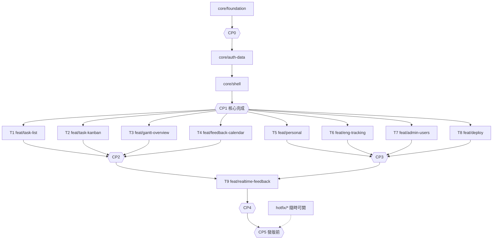

# PLAN — 實驗室專案管理工具（TasksSheets）

- 文件狀態：**待使用者審核**（核准前不進行任何實作）
- 建立日期：2026-11-24
- 適用流程：parallel-dev-orchestrator（core 先行 → worktree 平行軌道 → ff-only 合併 → 立即清理）

---

## 0. 摘要

| 項目 | 內容 |
|---|---|
| 技術 | TypeScript 全端：React + Vite（前端）、Hono（後端）、SQLite + Drizzle（資料）——皆可調整 |
| 核心 | 3 個序列分支：`core/foundation` → `core/auth-data` → `core/shell` |
| 平行軌道 | 第一波 8 條（分 1A / 1B 兩批，各 4 條），第二波 1 條（即時同步 + 即時回饋） |
| hotfix | `hotfix/<topic>`，隨時可開，獨立 ff-only 合併 |
| 檢查節點 | CP0（foundation）、CP1（核心完成）、CP2（1A）、CP3（1B）、CP4（第二波）、CP5（發版前） |
| 防踩檔關鍵 | 核心一次建好**全部 DB schema、全部路由掛載點、全部相依套件、跨功能插槽元件**；軌道只改自己的 feature 資料夾 |

---

## 1. 技術選型、目錄結構、DB schema、API

### 1.1 技術選型（全部標示為「可調整」）

| 層 | 選擇 | 理由 | 可替代方案 |
|---|---|---|---|
| 語言 | TypeScript（前後端共用） | 前後端共用型別與驗證 schema，減少契約落差 | — |
| 執行環境 | Node.js LTS（24 或 22） | 自架 server 最常見、部署單純 | Bun |
| 後端框架 | **Hono** + `@hono/node-server` | 輕量、TS 原生、`app.request()` 可直接做整合測試、內建 SSE helper | Fastify、Express |
| 驗證 | **Zod**（放在 `src/shared`） | 同一份 schema 同時做 API 驗證與前端表單型別 | Valibot |
| 資料庫 | **SQLite**（`better-sqlite3`，WAL 模式） | 單檔、零維運、實驗室規模綽綽有餘、備份就是複製檔案 | PostgreSQL（人數或併發大幅成長時） |
| ORM / migration | **Drizzle ORM** + drizzle-kit | 型別安全、貼近 SQL、migration 為純 SQL 檔好審查 | Kysely、Prisma |
| 密碼雜湊 | **argon2id**（`@node-rs/argon2`，有預編譯檔免 node-gyp） | 現行建議演算法；Windows 開發 / Linux 部署都免編譯 | bcrypt |
| Session | 伺服器端 session 存 SQLite + httpOnly cookie | 可立即撤銷、可精確實作 9 小時與閒置逾時；比 JWT 單純 | JWT（不建議） |
| 前端 | **React + Vite** | 生態最成熟，拖曳 / 甘特 / 日曆元件選擇多 | Vue、Svelte |
| 路由 | React Router | 常見、足夠 | TanStack Router |
| 伺服器狀態 | **TanStack Query** | 快取、輪詢、focus 重抓、樂觀更新都內建；最後階段接 SSE 只需做 invalidate | SWR |
| 樣式 | **Tailwind CSS** + CSS 變數設計 token | 快速做出一致的簡潔清亮介面，不需自建大型元件庫 | CSS Modules |
| 拖曳 | **dnd-kit** | Kanban 與「拖到 Calendar」共用同一套 | pragmatic-drag-and-drop |
| 甘特圖 | **自製輕量元件**（CSS grid / SVG） | 需求簡單（長條、進度、今日線），自製可完全貼合視覺；避免大型套件 | frappe-gantt |
| 日曆 | **自製月曆格**（date-fns） | 只需月檢視 + 放置區，FullCalendar 過重 | FullCalendar |
| 測試 | **Vitest**（單元 / API 整合）+ **Playwright**（E2E 冒煙） | Vite 生態原生；E2E 只保留少量關鍵流程 | — |
| 品質 | ESLint + Prettier + `tsc --noEmit` | 業界標準 | Biome |
| 部署 | 單一 Node 行程同時提供 API 與前端靜態檔；前面放反向代理（Caddy / nginx）做 HTTPS | 一個行程、一個 DB 檔，最容易維運 | Docker Compose |

刻意**不採用**：微服務、monorepo workspace、GraphQL、Redis、訊息佇列、CRDT 協作編輯。

### 1.2 目錄結構建議

```
TasksSheets/
├─ package.json              # 單一套件，不拆 workspace
├─ tsconfig.json  vite.config.ts  drizzle.config.ts  .env.example
├─ PLAN.md  PROGRESS.md  README.md
├─ docs/design/              # 前端設計規格，每軌道一份 <track>.md
├─ drizzle/                  # migration SQL（僅 core 與 hotfix/schema-* 可動）
├─ deploy/                   # 部署設定（feat/deploy）
├─ scripts/                  # seed、建立帳號、備份、worktree 回報腳本
├─ data/                     # SQLite 檔（已 gitignore）
├─ src/
│  ├─ shared/                # 前後端共用：zod schema、型別、常數（每個 feature 一個檔）
│  ├─ server/
│  │  ├─ index.ts            # 啟動
│  │  ├─ app.ts              # 掛載所有 feature router（core 一次掛好）
│  │  ├─ db/                 # schema.ts、client.ts、migrate.ts、seed.ts
│  │  ├─ lib/                # session、password、rateLimit、recordChange、errors
│  │  └─ features/
│  │     ├─ auth/ users/ projects/ tasks/ properties/      ← core 實作
│  │     └─ overview/ feedback/ personal/ eng/ admin/ sync/ ← core 放 stub，軌道實作
│  └─ web/
│     ├─ main.tsx  App.tsx  routes.tsx   # core 一次註冊所有頁面路由
│     ├─ styles/             # tokens.css（設計 token）
│     ├─ ui/                 # 基礎元件：Button、Input、Select、Dialog、Badge、Avatar、UpdatedAt…
│     ├─ lib/                # api client、queryClient、共用資料 hooks、openTask、日期工具
│     ├─ shell/              # AppShell、Sidebar、Header、ViewTabs、FilterBar
│     └─ features/
│        ├─ auth/                                           ← core 實作（登入頁）
│        └─ tasks/ kanban/ gantt/ overview/ feedback/ calendar/ personal/ eng/ admin/
│                                                           ← core 放 placeholder，軌道實作
└─ tests/
   ├─ e2e/                   # Playwright，每軌道一個 <track>.spec.ts
   └─ helpers/               # 測試用 DB、登入 helper（core 擁有）
```

單元 / 整合測試與原始碼同資料夾（`*.test.ts`），自然落在各軌道的檔案範圍內。

### 1.3 DB schema 概要

共通規則：
- 每張業務資料表都有 `created_at`、`updated_at`（INTEGER，unix ms），多數另有 `updated_by`。
- `updated_at` 由 Drizzle `$onUpdate` 自動寫入，**不依賴各軌道手動維護**；前端統一用 `<UpdatedAt>` 元件顯示（相對時間，hover 顯示絕對時間與修改者）。
- 純日期欄位（開始日、到期日、排程日）用 TEXT `YYYY-MM-DD`，避免時區位移。
- 主鍵用 INTEGER 自動遞增；排序欄位 `sort_order` 用 REAL（插入中間不必重編號）。
- **全部資料表在 `core/foundation` 一次建立**（含第一波軌道才會用到的表），軌道不新增 migration。

| 資料表 | 主要欄位 | 說明 |
|---|---|---|
| `users` | id, username(unique), display_name, password_hash, role(`admin`/`member`), is_active, must_change_password, created_at, updated_at | 之後擴充註冊 / 驗證時加 email、verified_at 即可 |
| `sessions` | id(token 的 SHA-256), user_id, created_at, expires_at(= created + 9h，不續期), last_active_at | 閒置逾時以 last_active_at 判斷 |
| `login_attempts` | id, username, ip, success, created_at | 登入失敗次數限制的依據 |
| `projects` | id, name, color, is_archived, sort_order, created_at, updated_at | 輕量專案分組，seed 一個預設專案 |
| `statuses` | id, name, color, category(`todo`/`doing`/`done`), sort_order, created_at, updated_at | seed：待辦 / 進行中 / 審查中 / 完成；category 供統計與 Kanban 使用 |
| `tasks` | id, project_id, title, description, status_id, assignee_id, priority, start_date, due_date, estimate_hours, progress(0–100), sort_order, **custom(JSON)**, created_by, updated_by, created_at, updated_at, deleted_at | 核心資料；軟刪除（所有人可互改，需能救回） |
| `property_defs` | id, project_id(null = 全域), name, type, options(JSON), sort_order, created_at, updated_at | 自訂 property 的定義 |
| `feedback_items` | id, project_id, kind(`problem`/`feedback`), title, body, status(`open`/`scheduled`/`resolved`), scheduled_date, reporter_id, assignee_id, updated_by, created_at, updated_at | 區域二；拖到日曆即寫入 scheduled_date |
| `personal_items` | id, user_id, title, note, is_done, task_id(nullable), sort_order, created_at, updated_at | 區域三；`task_id` 有值 = 標記的任務，無值 = 自由待辦 |
| `repos` | id, name, local_path, remote_slug, created_at, updated_at | 工程追蹤的 repo 設定 |
| `worktree_plans` | id, repo_id, path, branch, owner_id, task_id, purpose, created_at, updated_at | worktree 的「安排」（預期應存在者） |
| `worktree_snapshots` | id, repo_id, path, branch, head_sha, is_dirty, ahead, behind, last_commit_at, is_prunable, reported_by, reported_at | worktree 的「實際狀態」（偵測或回報所得） |
| `git_issues_cache` | repo_id, number, title, labels(JSON), assignee, url, issue_updated_at, fetched_at | 未處理 issue 的快取 |
| `changes` | id(遞增), entity_type, entity_id, action, actor_id, created_at | 變更流水；所有寫入 API 透過 `recordChange()` 寫一筆，最後階段的即時同步直接用它（保留 30 天） |

#### 自訂 property 設計

- **定義**放 `property_defs`；**值**放 `tasks.custom` JSON 欄位，格式 `{ "<property_id>": <value> }`。
- 支援型別：`text`、`number`、`select`、`multi_select`、`date`、`checkbox`、`url`、`person`。`select` 類的選項（id、label、color）存在 `options`。
- 選 JSON 欄位而非 EAV 表的理由：讀一筆任務不需 join、改值就是改任務本身（`updated_at` 自然更新）、程式最少。SQLite 的 `json_extract` 足以支援篩選與排序。
- 刪除 property 定義時不必清資料，讀取時忽略未知 key 即可。
- 寫入時後端依 `property_defs` 的型別以 Zod 驗證。
- 可調整：若日後需要對自訂欄位做大量索引查詢，再改為 EAV 表 `task_property_values`。

### 1.4 API 概要

REST + JSON，前綴 `/api`。除登入外全部需要有效 session；修改類請求檢查 `Origin` 並要求 `Content-Type: application/json`（搭配 `SameSite=Lax` cookie 防 CSRF）。錯誤格式統一 `{ error: { code, message } }`。

| 群組 | 端點 | 所屬 |
|---|---|---|
| 健康檢查 | `GET /api/health` | core |
| 認證 | `POST /api/auth/login`、`POST /api/auth/logout`、`GET /api/auth/me`、`POST /api/auth/password`、`POST /api/auth/heartbeat` | core |
| 成員 | `GET /api/users` | core |
| 專案 / 狀態 | `GET/POST/PATCH /api/projects`、`GET /api/statuses` | core |
| 任務 | `GET /api/tasks?project=&assignee=&status=&q=`、`POST /api/tasks`（只需 title）、`GET/PATCH/DELETE /api/tasks/:id` | core |
| 自訂 property | `GET/POST/PATCH/DELETE /api/properties` | core |
| 總覽 | `GET /api/overview`（每人進行中任務、預估工時合計、各狀態數量、逾期數） | feat/gantt-overview |
| 問題 / 回饋 | `GET/POST/PATCH/DELETE /api/feedback`（PATCH `scheduled_date` 即排入日曆） | feat/feedback-calendar |
| 個人清單 | `GET/POST/PATCH/DELETE /api/personal`、`PUT/DELETE /api/personal/pins/:taskId` | feat/personal |
| 工程追蹤 | `GET /api/eng/repos`、`GET /api/eng/issues`、`POST /api/eng/issues/refresh`、`GET /api/eng/worktrees`、`CRUD /api/eng/worktree-plans`、`POST /api/eng/worktrees/report` | feat/eng-tracking |
| 成員管理 | `GET/POST/PATCH /api/admin/users`、`POST /api/admin/users/:id/reset-password`、`POST /api/admin/users/:id/unlock` | feat/admin-users |
| 同步 | `GET /api/changes?since=<id>`、`GET /api/events`（SSE） | feat/realtime-feedback |

權限：登入後所有成員可讀寫所有任務與問題 / 回饋；個人清單僅本人可改；`/api/admin/*` 與 repo 設定僅管理員。

---

## 2. 核心範圍與驗收條件

核心在主 worktree 以三個分支**依序**完成，每個分支完成後 ff-only 合併回 `main` 並刪除分支。

### 2.1 `core/foundation`（無前端設計需求）

範圍：
- 專案骨架、TS / ESLint / Prettier / Vitest / Playwright 設定、npm scripts（`dev`、`build`、`start`、`lint`、`typecheck`、`test`、`test:e2e`、`check`）。
- **預先安裝全部規劃內的相依套件**（含 dnd-kit、date-fns 等軌道才用到者），之後軌道不得改 `package.json`。
- 完整 DB schema（1.3 全部資料表）、migration、seed（預設狀態、預設專案）。
- `src/shared` 全部 feature 的 schema 檔骨架；`.env.example` 列出**全部**環境變數。
- 後端 `app.ts` 掛好所有 feature router（未實作者回 501）、`/api/health`、統一錯誤處理、`recordChange()`。
- 測試 helper（暫存 DB、建立測試使用者）。

驗收：
- `npm run check`（lint + typecheck + test + build）全綠。
- 空目錄執行 migration + seed 可得到完整 schema；重跑 migration 無副作用。
- `GET /api/health` 回 200；所有 stub 路由回 501 而非 404。
- 跨平台：npm scripts 在 Windows PowerShell 與 Linux 都能跑（不使用 bash 專屬語法）。

### 2.2 `core/auth-data`（無前端設計需求）

範圍：
- 登入 / 登出 / `me` / 改密碼 / heartbeat；session middleware；argon2id 雜湊。
- Session 絕對期限 9 小時（不續期）；閒置逾時（預設 60 分鐘，環境變數可調）。
- 登入失敗限制：同帳號 15 分鐘內失敗 5 次即鎖定 15 分鐘；同 IP 15 分鐘內失敗 20 次即暫拒。回應訊息不洩漏帳號是否存在。
- 預設管理員帳號建立（方式見第 9 節 Q1）、`npm run user:add` CLI。
- 共用資料 API：users（列表）、projects、statuses、tasks、properties，全部寫入都呼叫 `recordChange()`。

驗收（皆有自動化整合測試）：
- 正確帳密可登入；錯誤帳密回 401；連續失敗達門檻後回 429，鎖定期滿可再登入。
- 未登入存取任何 `/api/*`（除 login、health）回 401。
- 以假時鐘驗證：登入 9 小時後 session 失效；閒置超過門檻後失效。
- **GET 輪詢與 SSE 不會刷新閒置計時**；只有 heartbeat 與寫入請求會刷新。
- DB 內無明文密碼；cookie 為 httpOnly、SameSite=Lax、正式環境 Secure。
- 成員 A 可修改成員 B 的任務；`updated_at`、`updated_by` 正確更新。
- 任務只給 title 即可建立（其餘欄位有預設值）；自訂 property 值依型別驗證，錯誤型別回 400。
- 任務軟刪除後不出現在列表。

### 2.3 `core/shell`（**需設計稿**：`docs/design/core-shell.md`）

範圍：
- 設計 token（色彩、字級、間距、圓角、陰影）與基礎元件（`src/web/ui`）。
- AppShell：側邊導覽（**所有頁面入口一次建好**）、頂欄、使用者選單（改密碼、登出）。
- 登入頁；路由守衛；收到 401 自動導回登入頁；前端閒置偵測（有操作才送 heartbeat，逾時自動登出）。
- `routes.tsx` 註冊所有頁面路由，各指向 feature 資料夾內的 placeholder。
- API client、queryClient（**基線多人可見性**：視窗 focus 重抓 + 清單類查詢每 30 秒輪詢）、共用資料 hooks（tasks / users / projects / statuses / properties）。
- 任務區共用：`ViewTabs`（List / Kanban / Gantt 切換）、`FilterBar`（專案 / 負責人 / 狀態 / 關鍵字，狀態存在 URL）。
- 共用顯示元件：`UpdatedAt`、`StatusBadge`、`Avatar`。
- **跨功能插槽元件**（core 提供可用的最小版，由指定軌道升級，其他軌道只管引用）：

| 插槽 | 位置 | core 最小版 | 升級軌道 |
|---|---|---|---|
| `QuickAdd` | `features/tasks/QuickAdd.tsx` | 輸入標題 + Enter 建立任務 | feat/task-list |
| `TaskDrawer` + `openTask(id)` | `features/tasks/TaskDrawer.tsx`、`lib/openTask.ts` | 以 `?task=<id>` 開啟，唯讀顯示基本欄位 | feat/task-list |
| `PinButton` | `features/personal/PinButton.tsx` | 不顯示（回傳 null） | feat/personal |

驗收：
- 登入後可看到 shell，側邊導覽每個入口都能進入對應 placeholder 頁，無 404、無 console error。
- 用最小版 QuickAdd 可建立任務；另一個瀏覽器在 30 秒內（或切回視窗時）看到該任務。
- 閒置逾時與 9 小時到期時前端自動回到登入頁。
- 首次以預設密碼登入會被要求改密碼。
- 介面符合設計規格的 token；1280px 以上桌面版面正常，768px 平板寬度不破版。
- E2E 冒煙：登入 → 逐一走訪導覽 → 快速新增任務 → 登出。

---

## 3. 平行軌道清單

共通規則：
- 分支 `feat/<track>`，worktree `../TasksSheets-<track>`，由 `main`（CP1 之後）建立。
- 每個軌道**只能修改自己檔案範圍內的檔案**，外加自己的 `docs/design/<track>.md` 與 `tests/e2e/<track>.spec.ts`。
- **CP1 之後核心檔案凍結**：`package.json`、`drizzle/`、`src/server/db/`、`src/server/app.ts`、`src/server/lib/`、core 的 server features、`src/web/routes.tsx`、`src/web/shell/`、`src/web/ui/`、`src/web/lib/`、`src/web/styles/`、`.env.example`。要改一律走 hotfix 線。
- 共通驗收（每條軌道都要符合）：
  1. `npm run check` 全綠，並附上該軌道的單元 / 整合測試與一個 E2E spec。
  2. `git diff --name-only main...HEAD` 的檔案全部落在檔案範圍內。
  3. 畫面上每個項目（列、卡片、詳情）都顯示最後更新日期（使用 `<UpdatedAt>`）。
  4. 所有寫入 API 都呼叫 `recordChange()`。
  5. 有空狀態、載入中、錯誤三種畫面。
- 每個 worktree 使用獨立的 DB 檔與連接埠（API `3100 + n`、Vite `5200 + n`，n 為下表編號），避免同時執行時互撞。
- 規模標示：S ≈ 半天內、M ≈ 一個工作階段、L ≈ 需較長工作階段（僅供排程參考）。

### 第一波 1A（主要功能）

#### T1 `feat/task-list` — List 檢視、快速新增、任務詳情、自訂 property（L）
| 項目 | 內容 |
|---|---|
| worktree | `../TasksSheets-task-list` |
| 檔案範圍 | `src/web/features/tasks/**` |
| 依賴 | 僅 core |
| 設計稿 | **需要**（`docs/design/task-list.md`） |

驗收：
- 快速新增：全域快捷鍵聚焦輸入框；Enter 建立後輸入框保持聚焦可連續新增；新任務不需重整即出現。
- List：可依狀態分組、可排序；標題、狀態、負責人、日期、預估工時皆可**就地編輯**；改狀態一次點擊完成。
- 自訂 property：可新增欄位（名稱 + 型別）、就地編輯值、改名、刪除（需確認）、顯示 / 隱藏欄位。
- 任務詳情抽屜：任何頁面以 `openTask(id)` 開啟，顯示全部欄位、自訂 property、最後更新時間與修改者。
- 篩選沿用 core 的 `FilterBar`。

#### T2 `feat/task-kanban` — Kanban 檢視（M）
| 項目 | 內容 |
|---|---|
| worktree | `../TasksSheets-task-kanban` |
| 檔案範圍 | `src/web/features/kanban/**` |
| 依賴 | 僅 core（引用 `QuickAdd`、`openTask`、`PinButton` 插槽） |
| 設計稿 | **需要**（`docs/design/task-kanban.md`） |

驗收：
- 欄位 = 狀態；卡片跨欄拖曳即改狀態，欄內拖曳可調順序，重整後順序保留。
- 卡片顯示標題、負責人、到期日、預估工時、最後更新；點擊開啟任務詳情。
- 每欄底部可快速新增（帶入該欄狀態）。
- 鍵盤可操作拖曳（dnd-kit 鍵盤感應器）。

#### T3 `feat/gantt-overview` — Gantt 檢視 + 總覽主畫面（L）
| 項目 | 內容 |
|---|---|
| worktree | `../TasksSheets-gantt-overview` |
| 檔案範圍 | `src/web/features/gantt/**`、`src/web/features/overview/**`、`src/server/features/overview/**`、`src/shared/overview.ts` |
| 依賴 | 僅 core |
| 設計稿 | **需要**（`docs/design/gantt-overview.md`） |

驗收：
- Gantt：時間軸可切換日 / 週 / 月；長條依開始日與到期日繪製並顯示進度；今日線；可依專案或負責人分組；點擊開啟任務詳情；拖曳長條可移動 / 調整日期。
- 沒有日期的任務另列於「未排程」區，不會消失。
- 總覽：
  - 甘特圖進度（精簡版，共用同一個 Gantt 元件）。
  - 成員卡片：目前進行中的任務、未完成任務的預估工時合計、待辦 / 進行中 / 完成數量、逾期數。
  - **沒有進行中任務的成員明顯標示為「目前無任務」並排在前面**，管理員一眼可辨。
  - 簡單統計：各狀態總數、本週完成數。
- `/api/overview` 以固定測試資料驗證彙總數字正確。

#### T4 `feat/feedback-calendar` — 區域二：問題 / 回饋清單 + Calendar（M–L）
| 項目 | 內容 |
|---|---|
| worktree | `../TasksSheets-feedback-calendar` |
| 檔案範圍 | `src/web/features/feedback/**`、`src/web/features/calendar/**`、`src/server/features/feedback/**`、`src/shared/feedback.ts` |
| 依賴 | 僅 core |
| 設計稿 | **需要**（`docs/design/feedback-calendar.md`） |

驗收：
- 問題 / 回饋的新增、編輯、刪除、標記已解決；可依類型與狀態篩選。
- 清單與月曆同頁；把項目**拖到某一天**即排入該日（狀態變為已排程）；可在日期間拖曳改期；拖回清單即取消排程。
- 重整後排程保留；月曆可切換月份、回到今天。
- 月曆以唯讀方式顯示任務到期日（次要，可延後）。

### 第一波 1B（輔助功能）

#### T5 `feat/personal` — 區域三：個人清單（S–M）
| 項目 | 內容 |
|---|---|
| worktree | `../TasksSheets-personal` |
| 檔案範圍 | `src/web/features/personal/**`（含 `PinButton`）、`src/server/features/personal/**`、`src/shared/personal.ts` |
| 依賴 | 僅 core |
| 設計稿 | **需要**（`docs/design/personal.md`，輕量） |

驗收：
- 個人頁三區：指派給我的任務、我標記的任務、自由待辦（新增 / 勾選 / 排序 / 刪除）。
- `PinButton` 可用：在任何引用處點擊即可把任務加入 / 移出自己的標記清單。
- 只有本人能改自己的清單（API 層以測試驗證 403）；可唯讀檢視其他成員的清單。

#### T6 `feat/eng-tracking` — 工程追蹤：git issue + worktree（M）
| 項目 | 內容 |
|---|---|
| worktree | `../TasksSheets-eng-tracking` |
| 檔案範圍 | `src/web/features/eng/**`、`src/server/features/eng/**`、`src/shared/eng.ts`、`scripts/report-worktrees.mjs` |
| 依賴 | 僅 core |
| 設計稿 | **需要**（`docs/design/eng-tracking.md`，輕量） |

驗收：
- Issue：依 repo 列出未關閉的 issue（編號、標題、標籤、負責人、更新時間、連結）；有快取與手動重新整理；顯示上次同步時間；未設定 token 時顯示明確提示而非報錯。
- Worktree：以「安排」對照「實際狀態」列表，並標示狀態：
  - 正常
  - **遺失**（有安排但實際不存在，或路徑已不在磁碟上）
  - 未登記（實際存在但沒有安排）
  - 已合併未清理（分支已併入 main 但 worktree 還在）
  - 有未提交變更 / 久未更新（預設 7 天）
- 可新增 / 編輯 / 刪除 worktree 安排（repo、分支、路徑、負責人、關聯任務、用途）。
- 安全：執行 git 一律用 `execFile` 傳參數陣列、只允許已登記的 repo 路徑、設定逾時。
- 測試：以暫存 git repo 驗證偵測邏輯；issue 來源以 mock 測試。

#### T7 `feat/admin-users` — 成員管理（S）
| 項目 | 內容 |
|---|---|
| worktree | `../TasksSheets-admin-users` |
| 檔案範圍 | `src/web/features/admin/**`、`src/server/features/admin/**`、`src/shared/admin.ts` |
| 依賴 | 僅 core |
| 設計稿 | **需要**（`docs/design/admin-users.md`，輕量） |

驗收：
- 管理員可列出成員、新增成員（給臨時密碼，首次登入強制改密碼）、停用 / 啟用、重設密碼、調整角色、解除登入鎖定。
- 一般成員存取 `/api/admin/*` 回 403，側邊導覽不顯示入口。
- 不可停用或降級最後一位管理員；被停用者的現有 session 立即失效。

#### T8 `feat/deploy` — 部署與備份（S，無前端）
| 項目 | 內容 |
|---|---|
| worktree | `../TasksSheets-deploy` |
| 檔案範圍 | `deploy/**`、`scripts/backup.*`、`README.md` |
| 依賴 | 僅 core |
| 設計稿 | 不需要 |

驗收：
- 依 README 可在乾淨主機上從零完成：安裝 → 設定 `.env` → migration → 啟動 → 反向代理 HTTPS。
- 正式模式單一行程同時提供 API 與前端靜態檔；提供 systemd unit（或 compose 檔）範例。
- 備份腳本可在服務運行中產生一致的 SQLite 備份；完成一次還原演練並記錄步驟。

### 第二波（最後階段）

#### T9 `feat/realtime-feedback` — 多人即時同步 + 即時 UI 回饋（M–L）
| 項目 | 內容 |
|---|---|
| worktree | `../TasksSheets-realtime-feedback` |
| 檔案範圍 | `src/server/features/sync/**`、`src/web/lib/**`、`src/web/ui/**`、`src/web/styles/**`，以及為加入動畫 / toast 而需調整的 `src/web/features/**`（此波僅此一條前端軌道，獨佔前端） |
| 依賴 | 第一波全部合併（CP2、CP3 通過） |
| 設計稿 | **需要**（`docs/design/realtime-feedback.md`：toast 樣式與文案、動畫時長與曲線） |

驗收：
- 兩個瀏覽器同時開啟：A 的新增 / 修改 / 刪除在 B **2 秒內**出現，不需重整。
- SSE 斷線自動重連；無法連線時退回輪詢；SSE 連線不計入使用者活動（不影響閒置登出）。
- 寫入成功 / 失敗有 toast；失敗時樂觀更新會回復。
- 他人修改了我正在看的項目時有提示（誰、改了什麼項目）。
- 動畫：清單增刪、Kanban 拖放、抽屜開合；尊重 `prefers-reduced-motion`。
- 閒置登出前 5 分鐘有提醒，可一鍵延續。

---

## 4. 合併原則（哪些功能因同檔而合併）

| 合併為同一軌道 | 原因 |
|---|---|
| List 檢視 + 快速新增 + 任務詳情抽屜 + 自訂 property 介面 → **T1** | 全在 `features/tasks/`：就地編輯器、property 編輯器同時被 List 列與詳情抽屜使用；快速新增與 List 的插入列是同一元件 |
| Gantt 檢視 + 總覽主畫面 → **T3** | 總覽要嵌入甘特圖，兩者共用同一個 Gantt 元件與時間軸計算；拆開就會形成軌道間依賴 |
| 問題 / 回饋清單 + Calendar → **T4** | 拖曳的來源（清單）與放置目標（月曆）必須在同一個拖曳 context，且共用同一支 API |
| git issue + worktree 追蹤 → **T6** | 共用 `repos` 設定、同一頁面、同一個 server feature 資料夾 |
| 即時同步 + toast / 動畫 → **T9** | 都要改 queryClient 與全域 provider；「他人變更提示」本身就是同步事件觸發的 toast；且兩者都是橫切全前端的修改 |
| 全部 DB schema + 全部路由掛載 + 全部相依套件 → **core** | `schema.ts`、`app.ts`、`routes.tsx`、`package.json` 是所有功能都會碰的檔案，集中在核心一次完成才能讓軌道互不踩檔 |

刻意**不合併**的：
- Kanban（T2）與 List（T1）：Kanban 自成一個資料夾，只透過 core hooks 與插槽元件互動，無共用檔案；且 T1 已是最大軌道，分開可平衡工作量。若希望減少軌道數，可併入 T1。
- 個人清單（T5）：與任務檢視的唯一交集是 `PinButton`，已用插槽解耦。

---

## 5. hotfix 線規劃

- 分支 `hotfix/<topic>`，由最新 `main` 建立；worktree `../TasksSheets-hotfix-<topic>`。
- 可隨時開始，與平行軌道同時進行。
- 適用情境與命名：

| 情境 | 命名 |
|---|---|
| 已合併功能的錯誤 | `hotfix/<bug 主題>` |
| DB schema 需要調整 | `hotfix/schema-<topic>` |
| 核心契約 / 共用元件 / 共用 hook 需要調整 | `hotfix/core-<topic>` |
| 需要新增相依套件 | `hotfix/deps-<topic>` |

- 規則：
  1. 一個 hotfix 只做一件事，範圍越小越好。
  2. **會動到核心凍結檔案的 hotfix 一次只開一條**，由協調者排隊，避免彼此衝突。
  3. 完成後跑 `npm run check` 與相關測試 → rebase 到最新 `main` → `git merge --ff-only` → 立即 `git worktree remove` 與 `git branch -d`。
  4. 合併後協調者通知所有進行中的軌道 rebase 到最新 `main`。
  5. 每條 hotfix 都記入 PROGRESS.md（原因、影響軌道）。
- 執行者：實作者 opus5.5 medium；涉及畫面變動且非單純修錯時，先由前端設計者補一段設計說明。

---

## 6. 檢查節點表

測試指令：`npm run check` = `lint` + `typecheck` + `test`（Vitest）+ `build`；`npm run test:e2e` = Playwright。

| 節點 | 時機 | 要跑的測試 | 通過條件 |
|---|---|---|---|
| **CP0** foundation | `core/foundation` 合併後 | `npm run check`；空 DB 跑 migration + seed | 全綠；schema 完整；stub 路由回 501；Windows 可執行所有 scripts |
| **CP1** 核心完成 | `core/shell` 合併後 | `npm run check`；`npm run test:e2e`（核心冒煙）；認證整合測試（鎖定、9 小時、閒置） | 全綠；2.1–2.3 驗收全數符合；所有導覽入口可進入；插槽元件可用。**通過後才建立任何軌道 worktree，並宣告核心檔案凍結** |
| **CP2** 第一波 1A | T1–T4 全部合併後 | 在 `main` 上跑 `npm run check` + 全部 E2E；檔案範圍稽核；手動走訪 List / Kanban / Gantt / 總覽 / 回饋日曆 | 全綠；各軌道驗收符合；無跨軌道踩檔；`git worktree list` 只剩主 worktree 與進行中的軌道；PROGRESS.md 已更新 |
| **CP3** 第一波 1B | T5–T8 全部合併後 | 同上；另驗證 `PinButton` 在 List 與 Kanban 中生效；依 README 做一次部署演練 | 同上；部署演練成功。**CP2 與 CP3 都通過才解鎖 T9** |
| **CP4** 第二波 | T9 合併後 | `npm run check` + 全部 E2E；雙瀏覽器同步測試；斷線重連測試；`prefers-reduced-motion` 檢查 | 全綠；T9 驗收符合；先前所有 E2E 無回歸 |
| **CP5** 發版前 | 發版前 | 全部測試；正式模式 build + 啟動；全新 DB 的 migration + seed；備份 / 還原演練；`npm audit`；安全檢查清單（cookie 旗標、預設密碼強制更改、登入限制、`.env` 未入版控）；兩人以上實際試用 | 全綠；無高風險漏洞；安全清單全過；`git worktree list` 只剩主 worktree；無殘留 `feat/*`、`hotfix/*` 分支 |

每個節點固定動作：在 `main` 跑完整測試 → 確認無檔案衝突 → 更新 PROGRESS.md → 向使用者回報「已合併 / 進行中 / 阻塞中」。

單一軌道合併前的小檢查（非節點）：該軌道 rebase 到最新 `main` → `npm run check` → 該軌道 E2E → 檔案範圍稽核 → ff-only 合併 → 移除 worktree 與分支。

---

## 7. 依賴圖與波次安排



| 波次 | 內容 | 可否平行 |
|---|---|---|
| 第 0 波（核心） | `core/foundation` → `core/auth-data` → `core/shell` | 序列。`core/shell` 的設計規格可在 `core/auth-data` 實作期間先行產出（只產文件，不碰程式） |
| 第一波 1A | T1、T2、T3、T4 | 4 條同時進行 |
| 第一波 1B | T5、T6、T7、T8 | 4 條同時進行 |
| 第二波 | T9 | 單獨進行 |
| hotfix | 隨時 | 與任何波次並行 |

說明：
- T1–T8 **彼此沒有依賴**，全部只依賴 core。分成 1A / 1B 純粹是為了限制同時開啟的 worktree 數量（每個 worktree 都要一份 `node_modules` 與一個 agent，會佔用記憶體與磁碟）。機器資源足夠時可 8 條全開；1A 有軌道提早合併並清理後，也可立即遞補 1B 的軌道。
- T9 必須等第一波全部合併，因為它會橫切修改各 feature 的前端檔案。

---

## 8. 每階段所用 agent 的 model / effort

| 階段 | 角色 | model / effort | 產出 |
|---|---|---|---|
| 規劃 | 規劃者 | fable5.1 medium | 本文件 |
| 協調（全程） | 協調者（主線程） | 目前 session | git 初始化、worktree、合併、檢查節點、清理、PROGRESS.md、回報 |
| `core/foundation` | 實作者 | opus5.5 medium | 骨架、schema、工具鏈 |
| `core/auth-data` | 實作者 | opus5.5 medium | 認證與共用資料 API |
| `core/shell` 設計 | 前端設計者 | fable5.1 low | `docs/design/core-shell.md` |
| `core/shell` 實作 | 實作者 | opus5.5 medium | shell、基礎元件、插槽 |
| T1–T7、T9 設計 | 前端設計者 | fable5.1 low（每軌道一個 agent） | `docs/design/<track>.md` |
| T1–T9 實作 | 實作者 | opus5.5 medium（每個 worktree 一個 agent） | 功能程式與測試 |
| T8 | 實作者 | opus5.5 medium | 部署設定（無設計階段） |
| 檢查節點未過的修正 | 實作者 | opus5.5 medium | 於對應軌道或 hotfix 線修正 |
| hotfix | 實作者 | opus5.5 medium | 單一修正 |

補充：
- 前端設計者若 fable5.1 不可用，改用 fable5.2 low。
- 若派工時無法指定 effort 參數，改在 prompt 內以文字要求對應思考深度，並在 PROGRESS.md 註記實際設定。
- 設計規格的內容要求：版面線框（文字示意）、元件清單與各狀態（預設 / hover / 選取 / 停用 / 空 / 載入 / 錯誤）、使用的 token、互動流程、鍵盤操作、響應式斷點。設計者只寫文件，不寫程式。
- 整體視覺方向：淺色主題、白或近白底、單一強調色、留白充足、資訊密度適中。

---

## 9. 風險與待使用者決定的問題

### 9.1 待決定問題（附建議預設值；未回覆即採預設）

| # | 問題 | 建議預設 | 影響 |
|---|---|---|---|
| Q1 | 預設帳密如何設定？ | **不把密碼寫進程式碼**。首次啟動時從 `.env` 的 `ADMIN_USERNAME` / `ADMIN_PASSWORD` 建立管理員；未設定則產生隨機密碼並只在 server 主控台顯示一次。首次登入強制改密碼。其他成員由管理員在成員管理頁建立 | core/auth-data |
| Q2 | 閒置多久自動登出？ | 60 分鐘（環境變數可調）；絕對上限 9 小時 | core/auth-data |
| Q3 | 登入失敗限制的門檻？ | 同帳號 15 分鐘內 5 次失敗鎖 15 分鐘；同 IP 15 分鐘內 20 次 | core/auth-data |
| Q4 | git issue 的來源？ | **GitHub**（REST API，唯讀 token 放 `.env`），快取 5 分鐘 + 手動重新整理。來源包成單一介面，日後可換成 Gitea / GitLab。註：git 本身沒有 issue，「本機」只能指自架的 Gitea / GitLab 這類服務 | T6 |
| Q5 | **被追蹤的 repo 在哪台機器上？**（決定 worktree 如何偵測） | 模式 A：repo 在 server 上（或已掛載），server 直接執行 `git worktree list --porcelain` 等指令讀取。若 repo 在各人電腦上，改用模式 B：在開發機執行 `scripts/report-worktrees.mjs` 把狀態回報給 server（需設定回報 token）。偵測邏輯寫成共用模組，兩種模式共用。**預設先做 A；此題最需要使用者確認** | T6 |
| Q6 | worktree「遺失」的判定規則？ | 有安排但實際不存在、或路徑已不在磁碟上 = 遺失；另標示未登記、已合併未清理、有未提交變更、超過 7 天未更新 | T6 |
| Q7 | 即時同步用 SSE 還是輪詢？ | **SSE**（單向推送「某項目已變更」，前端據此重抓），並保留輪詢作為後備。最後階段之前先以 30 秒輪詢 + 視窗 focus 重抓作為基線 | core/shell、T9 |
| Q8 | 兩人同時改同一筆任務怎麼處理？ | 欄位層級的後寫入者勝（PATCH 只送改動的欄位），不做鎖定；T9 加上「某人剛更新了此項目」提示 | core、T9 |
| Q9 | 需要多專案嗎？ | 輕量多專案（一張 `projects` 表，預設建立一個專案） | core |
| Q10 | 甘特圖要自製還是用套件？是否需要任務相依線、子任務？ | 自製輕量元件；**不做**相依線與子任務（需求未提及） | T3 |
| Q11 | 自訂 property 是全域還是每專案各自定義？ | 可綁專案，未綁則全域 | core、T1 |
| Q12 | 個人清單其他人看得到嗎？ | 其他成員可唯讀檢視，只有本人能改 | T5 |
| Q13 | 快速新增是否支援語法（如 `@負責人`、`#專案`）？ | 先只支援「標題 + Enter」連續新增，語法日後再加 | T1 |
| Q14 | 成員管理頁（T7）與部署軌道（T8）是否納入？ | 納入。不納入 T7 的話，新增成員只能上 server 執行 CLI | T7、T8 |
| Q15 | 部署方式與網路環境？ | Node 單一行程 + systemd + Caddy 反向代理；僅實驗室內網或 VPN 可存取；每日備份 SQLite | T8 |
| Q16 | 同時開啟的 worktree 上限？ | 4 條（即 1A / 1B 分批） | 排程 |
| Q17 | 介面語言與時區？ | 繁體中文介面、Asia/Taipei | 全部 |

### 9.2 風險與對策

| 風險 | 對策 |
|---|---|
| 核心範圍偏大，拖慢平行軌道起跑 | 核心只做「最小可用」：插槽元件只做最小版；core/shell 的設計規格提前產出；CP0 提早驗證骨架 |
| 核心契約不夠用，軌道中途需要改核心檔案 | 統一走 `hotfix/core-*`、`hotfix/schema-*`，一次一條並通知各軌道 rebase；CP1 前由協調者對照各軌道驗收條件檢查契約是否齊全 |
| `package.json` / lockfile 衝突 | 相依套件在 foundation 一次裝齊；軌道禁止修改，需新增走 `hotfix/deps-*` |
| 背景輪詢或 SSE 讓 session 永不閒置 | 閒置計時只由 heartbeat（有實際操作才送）與寫入請求刷新，並有自動化測試把關 |
| 所有人可互改任務，誤刪難以追回 | 任務軟刪除；`changes` 表保留變更流水 |
| 拖曳互動（Kanban、Calendar、Gantt）實作量超出預期 | Gantt 拖曳改日期、月曆顯示任務到期日列為次要項目，時間不足可延到 hotfix 之後補 |
| server 執行 git 指令與保存 GitHub token 的安全性 | `execFile` + 參數陣列、路徑白名單、逾時；token 只放 `.env`、最小唯讀權限、不回傳前端 |
| SSE 被反向代理緩衝或逾時中斷 | 部署文件註明關閉該路徑的緩衝；定時送心跳訊息；前端自動重連並退回輪詢 |
| 開發機為 Windows、server 可能為 Linux | 原生模組選有預編譯檔者；npm scripts 不用 shell 專屬語法；路徑處理一律用 `node:path` |
| 多個 worktree 同時跑造成記憶體 / 磁碟吃緊、連接埠相撞 | 同時上限 4 條；每軌道分配固定連接埠與獨立 DB 檔；合併後立即移除 worktree |
| T9 橫切修改前端，若此時有 hotfix 易衝突 | 第二波期間 hotfix 盡量小；T9 每次 hotfix 合併後立即 rebase |
| 指定模型不可用 | 依備援規則改用 fable5.2 low，並在 PROGRESS.md 註記 |

---

## 10. 預估軌道數量與切分理由

| 類別 | 數量 | 內容 |
|---|---|---|
| 核心分支（序列） | 3 | `core/foundation`、`core/auth-data`、`core/shell` |
| 第一波平行軌道 | 8 | T1 task-list、T2 task-kanban、T3 gantt-overview、T4 feedback-calendar、T5 personal、T6 eng-tracking、T7 admin-users、T8 deploy |
| 第二波軌道 | 1 | T9 realtime-feedback |
| hotfix | 依需要 | 預估 3–6 條小型修正 |
| **feat 軌道合計** | **9** | 其中 8 條需要前端設計稿（T8 除外） |

切分理由：
1. **以「資料夾擁有權」為切分單位**：每條軌道對應一到兩個 feature 資料夾，前後端都只在自己的資料夾內工作，所以 8 條軌道可以真正同時進行而不互相等待。
2. **會共用檔案的就合併**：List / 快速新增 / 詳情 / 自訂 property 共用編輯元件；Gantt 與總覽共用甘特元件；回饋清單與日曆共用拖曳 context；issue 與 worktree 共用 repo 設定；同步與 toast 共用全域 provider（見第 4 節）。
3. **所有人都會碰的檔案收進核心**：schema、路由掛載、導覽、相依套件、共用元件一次到位，並用「插槽元件」解掉跨功能的引用關係（快速新增、任務詳情、標記按鈕），讓軌道之間零依賴。
4. **核心拆三段**是為了讓每段都有明確的檢查點與單一責任（骨架 / 後端 / 前端），而不是一個過大的分支；其中只有 shell 需要設計稿。
5. **即時回饋與即時同步放最後且獨佔一波**：兩者都橫切全部前端，放在功能穩定後一次處理，避免與功能軌道互相干擾，也符合「留到最後階段」的要求。
6. **軌道數的彈性**：想更精簡可把 T2 併入 T1、T7 改為只留 CLI、T8 延到發版前以 hotfix 型式處理，最少可降到 6 條 feat 軌道；目前的 9 條是在「平行度」與「每條軌道夠小、好驗收」之間的建議平衡點。

---

## 附錄：流程規範速查

- 合併一律 `git merge --ff-only`；不成功就先 rebase 再重試；不產生 merge commit；不 force-push `main`。
- 軌道完成順序：worktree 內 commit（訊息用繁體中文，格式 `類型: 摘要`）→ rebase 到最新 `main` → 測試 → 協調者 ff-only 合併 → **立即** `git worktree remove` + `git branch -d`。
- agent 失敗或放棄時同樣移除 worktree，並在 PROGRESS.md 記錄原因。
- 每次合併與每個檢查節點都更新 PROGRESS.md。
- 使用者核准本規劃前，不建立任何 `core/*`、`feat/*` 分支，不開始實作。
